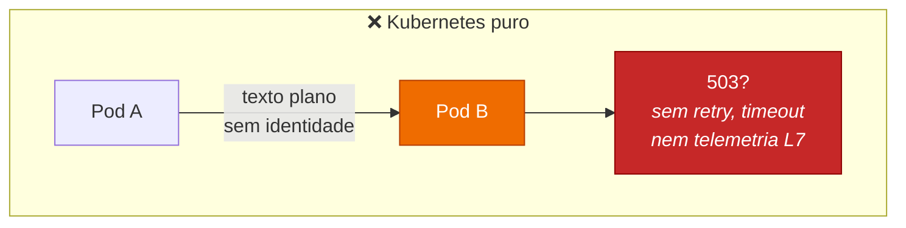
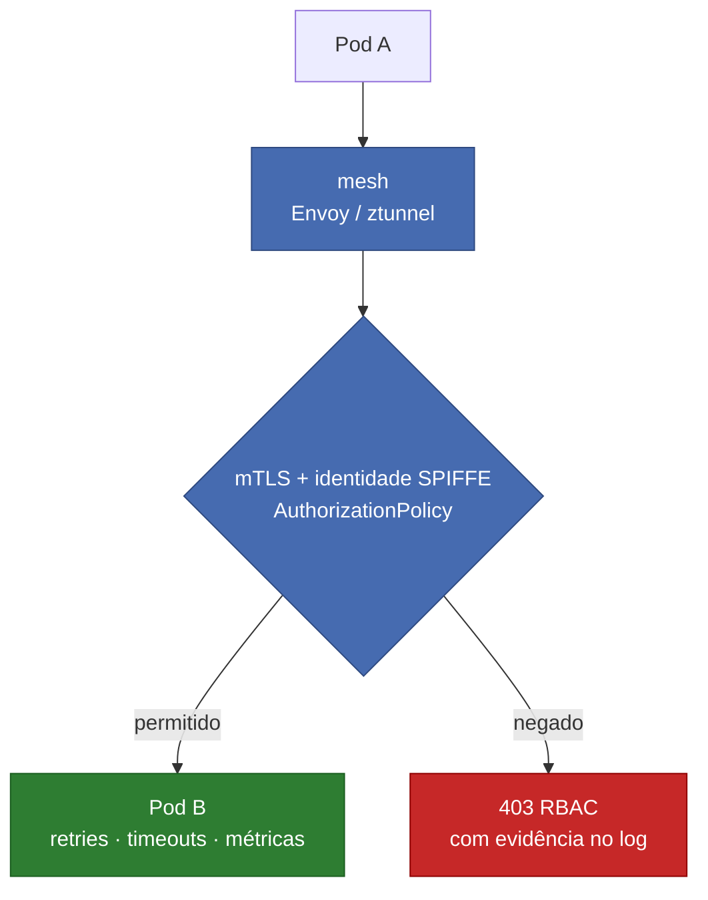
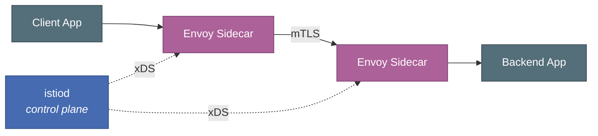
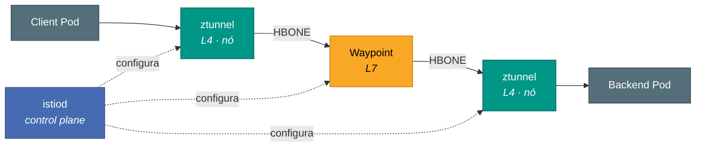
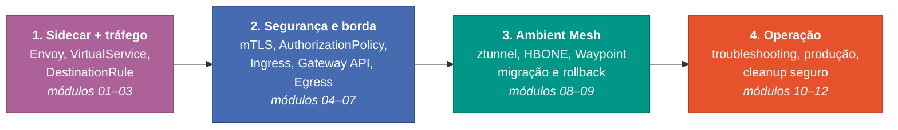
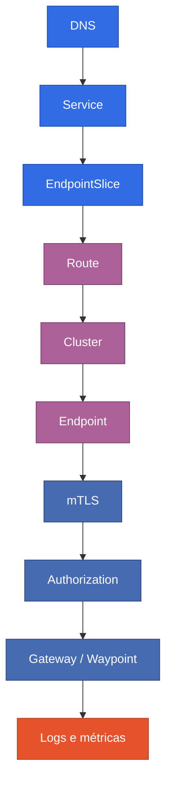

<div align="center">


# SRE — Service Mesh com Istio no Amazon EKS

**Curso prático de Istio para SRE, Cloud e DevOps Engineers**

Do tráfego Kubernetes puro até Sidecar Mode, Ambient Mesh, mTLS,<br/>
AuthorizationPolicy, Gateway API, Egress, Waypoint e troubleshooting de produção.


</div>

---

> **Objetivo do curso:** sair de “qual YAML eu aplico?” para “qual camada do tráfego está falhando, qual evidência comprova a hipótese e qual é a forma mais segura de corrigir em produção?”.

---

## Filosofia do curso

Este material não é uma coleção de manifests sem contexto.

Em cada módulo você encontrará:

1. **Objetivo** — o que vamos construir.
2. **Teoria** — por que o recurso existe.
3. **Arquitetura** — onde ele entra no fluxo.
4. **LAB** — comandos e manifests.
5. **Validação** — como provar que funcionou.
6. **Produção** — o que muda fora do laboratório.
7. **Problemas comuns** — falhas recorrentes.
8. **Troubleshooting** — como investigar.
9. **Checkpoint** — o que precisa estar claro antes de avançar.

O curso usa o mesmo princípio dos demais repositórios SRE deste autor: **fundamentos → prática → troubleshooting → produção**.

---

## Pré-requisitos

### EKS é obrigatório

O curso **não ensina a criar o cluster EKS**. O cluster deve ser criado a partir do repositório [`sre-aws-eks`](https://github.com/alanmosilva/sre-aws-eks).

Depois de provisionar o cluster, atualize o kubeconfig e valide:

```bash
aws eks update-kubeconfig \
  --region <REGIAO> \
  --name <NOME_DO_CLUSTER>

aws sts get-caller-identity
kubectl get nodes
kubectl get pods -A
```

> Atalho: [`scripts/check-environment.sh`](scripts/check-environment.sh) faz essas validações de uma vez.

### Ferramentas

| Ferramenta | Uso | Como verificar |
|---|---|---|
| AWS CLI | acesso à AWS | `aws sts get-caller-identity` |
| `kubectl` | Kubernetes | `kubectl get nodes` |
| `istioctl` | instalação, diagnóstico e operação do Istio | `istioctl version --remote=false` |
| `curl` | testes HTTP/HTTPS | `curl --version` |
| `openssl` | laboratório TLS | `openssl version` |
| `dig` / `nslookup` | troubleshooting DNS | `dig -v` |
| Terraform | destruir o EKS ao final pelo repo base | `terraform version` |

### Instalação do istioctl

```bash
curl -L https://istio.io/downloadIstio \
  | ISTIO_VERSION=1.31.1 TARGET_ARCH=x86_64 sh -

cd istio-1.31.1
export PATH="$PWD/bin:$PATH"

istioctl version --remote=false
```

> Ou use [`scripts/install-istioctl.sh`](scripts/install-istioctl.sh).

### Versões usadas no curso

| Componente | Versão |
|---|---|
| Istio | **1.31.1** |
| Gateway API CRDs | **v1.6.0** |
| Kubernetes | compatível com o Istio 1.31 |
| Ambiente | Amazon EKS |

Detalhes em [`reference/VERSIONS.md`](reference/VERSIONS.md).

> Antes de repetir o curso meses depois, confira compatibilidade entre Istio, Kubernetes e Gateway API.

---

## O problema que o curso resolve





---

## Arquitetura conceitual

### Sidecar Mode



### Ambient Mesh



---

## Evolução do curso

O curso avança em quatro degraus, cada um apoiado no anterior:



---

## Módulos

| # | Módulo | Foco |
|---|---|---|
| 01 | [Fundamentos de Service Mesh e Istio](01-fundamentos-service-mesh/) | problema, control plane, data plane |
| 02 | [Sidecar Mode e Envoy](02-sidecar-envoy/) | injection, listeners, routes, clusters, endpoints |
| 03 | [Traffic Management](03-traffic-management/) | VirtualService, DestinationRule, retries, timeouts, faults |
| 04 | [Segurança no Mesh](04-seguranca-mtls-authz/) | mTLS, identidade, PeerAuthentication, AuthorizationPolicy |
| 05 | [Ingress, NLB, TLS e Gateway API](05-ingress-gateway-tls/) | tráfego externo e HTTPS |
| 06 | [Telemetria e diagnóstico](06-telemetria-diagnostico/) | métricas, logs e Kiali |
| 07 | [Egress](07-egress/) | ServiceEntry, REGISTRY_ONLY e Egress Gateway |
| 08 | [Ambient Mesh](08-ambient-mesh/) | ztunnel, HBONE, Waypoint, HTTPRoute |
| 09 | [Sidecar vs Ambient](09-sidecar-vs-ambient/) | diferenças, migração e rollback |
| 10 | [Troubleshooting prático](10-troubleshooting/) | 503, NR, UH, RBAC, mTLS, Waypoint |
| 11 | [Istio em produção](11-producao/) | HA, capacity, PDB, upgrade, segurança |
| 12 | [Revisão geral e cleanup](12-revisao-cleanup/) | resumão + desmontagem segura |

Além dos módulos:

- [`CHECKLIST.md`](CHECKLIST.md) — o que você deve ter ao final
- [`reference/VERSIONS.md`](reference/VERSIONS.md) — versões usadas
- [`reference/COMANDOS-RAPIDOS.md`](reference/COMANDOS-RAPIDOS.md) — consulta rápida de comandos
- [`reference/TROUBLESHOOTING.md`](reference/TROUBLESHOOTING.md) — guia de investigação
- [`scripts/`](scripts/) — checagem de ambiente, instalação do `istioctl` e pré-destroy

---

## Convenções usadas

Cada módulo é autocontido: o `README.md` e os manifests que ele usa ficam no mesmo diretório.

| Namespace | Uso |
|---|---|
| `istio-system` | control plane |
| `istio-lab` | Sidecar Mode |
| `legacy` | workload fora do mesh |
| `istio-ingress` | ingress gateway |
| `gateway-api-lab` | Gateway API |
| `istio-egress` | egress gateway |
| `ambient-lab` | Ambient Mesh |

Demais convenções:

- Istio: `1.31.1`
- Gateway API CRDs: `v1.6.0`
- Imagem de teste: `curlimages/curl:8.10.1`
- Imagem de echo: `hashicorp/http-echo:1.0`

---

## Regra de ouro do curso

Antes de culpar o Istio, desça a pilha na ordem:



> **Istio não conserta Service sem endpoint, DNS quebrado ou aplicação não saudável.**

---

## Importante: LAB x PRODUÇÃO

Os manifests deste repositório foram feitos para aprendizado. Em produção, avalie no mínimo:

| Disponibilidade | Segurança | Operação |
|---|---|---|
| alta disponibilidade | políticas de segurança | estratégia de upgrade |
| requests/limits | backup de configurações | observabilidade |
| PDB | change management | rollback |
| HPA | | impacto de custo |
| distribuição por AZ | | |

O módulo 11 aprofunda cada um desses pontos.

---

## Ordem recomendada

Execute os módulos em sequência.

O Sidecar Mode (02–07) vem antes do Ambient (08) de propósito: com o Envoy dentro do pod, fica fácil inspecionar listeners, routes, clusters e endpoints com `istioctl proxy-config`. Esse modelo mental é o que torna o ztunnel e o Waypoint compreensíveis depois.

O 09 só faz sentido depois de ter os dois modos rodando — é onde você compara, migra e pratica o rollback.

---

## Limpeza

> [!WARNING]
> **Não execute `terraform destroy` antes de remover os recursos de LoadBalancer criados pelo Istio/Gateway API.**
> Gateway API pode ser o owner do Service que provisiona o NLB. Excluir apenas o Service pode fazer o controller recriá-lo.

Use o [Módulo 12](12-revisao-cleanup/) para a desmontagem completa.

Validação obrigatória antes do Terraform:

```bash
kubectl get svc -A \
  --field-selector spec.type=LoadBalancer
```

> Atalho: [`scripts/pre-destroy-check.sh`](scripts/pre-destroy-check.sh) lista Services LoadBalancer, Gateways, HTTPRoutes e os Load Balancers na AWS.

Somente depois remova o EKS pelo repositório [`sre-aws-eks`](https://github.com/alanmosilva/sre-aws-eks).

---

## Estrutura do repositório

```text
SRE-Istio-Curso/
├── 01-fundamentos-service-mesh/
├── 02-sidecar-envoy/
├── 03-traffic-management/
├── 04-seguranca-mtls-authz/
├── 05-ingress-gateway-tls/
├── 06-telemetria-diagnostico/
├── 07-egress/
├── 08-ambient-mesh/
├── 09-sidecar-vs-ambient/
├── 10-troubleshooting/
├── 11-producao/
├── 12-revisao-cleanup/
├── reference/
├── scripts/
├── CHECKLIST.md
├── LICENSE
└── README.md
```

---

## Resultado esperado

Ao concluir o curso, você deve conseguir explicar e operar:

| Mesh | Tráfego | Operação |
|---|---|---|
| control plane e data plane | VirtualService | troubleshooting de 403/503/NR/UH |
| Envoy Sidecar | DestinationRule | migração Sidecar → Ambient |
| Ambient Mesh | HTTPRoute | cleanup seguro do ambiente |
| ztunnel e Waypoint | ingress e egress | |
| mTLS e SPIFFE identity | Gateway API | |
| AuthorizationPolicy | | |
